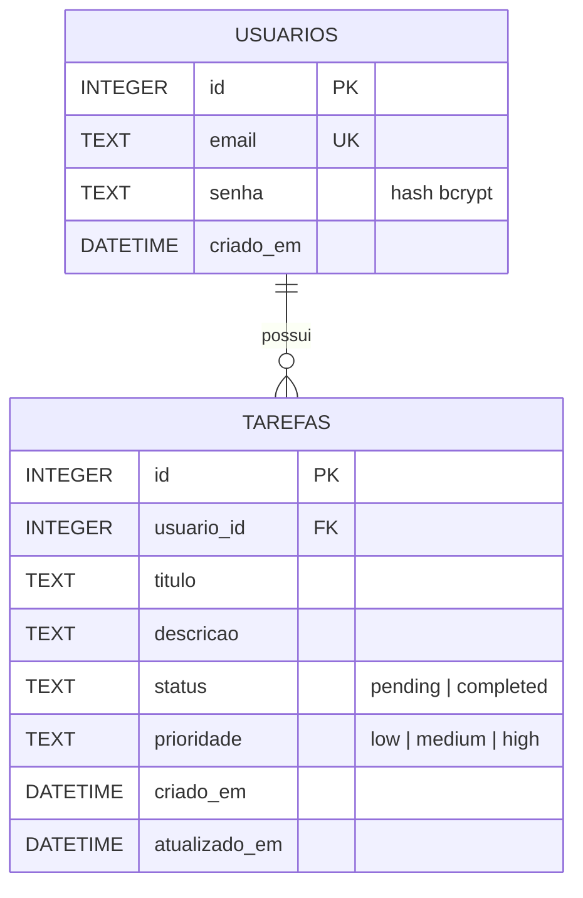
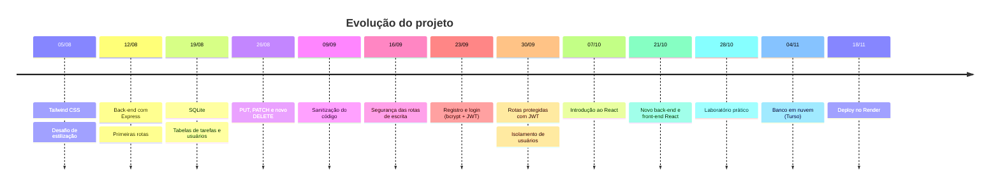

<div align="center">

# Gerenciador de Tarefas Multi-Usuário

**Disciplina de Desenvolvimento de Sistemas Web**

Aplicação full-stack de tarefas: API REST com autenticação JWT, banco em nuvem (Turso / libSQL), front-end em React + Tailwind CSS e deploy no Render.


**Estudante:** Thiago Borsatto Dutra

[Objetivo](#objetivo) •
[Como rodar](#como-rodar) •
[Deploy](#deploy-no-render) •
[Endpoints](#endpoints-da-api) •
[Estrutura](#estrutura-do-projeto) •
[Diário de aulas](#diário-de-aulas) •
[Semanário](#semanário)

</div>

---

## Objetivo

Desenvolver um **gerenciador de tarefas completo e multi-usuário**, do back-end ao deploy, aplicando boas práticas de segurança: validação de entradas, consultas parametrizadas, tratamento de erros sem vazamento de informações e autenticação com **bcrypt + JWT**. Os dados ficam em um banco **libSQL na nuvem (Turso)**, e o mesmo servidor Express entrega a API e o front-end React.

## Funcionalidades

| | Recurso | Descrição |
|:-:|---|---|
| ▸ | **CRUD de tarefas** | Criar, listar, buscar, atualizar (total e parcial) e excluir tarefas |
| ▸ | **Busca por título** | `GET /api/tasks?search=termo` com consulta parametrizada (proteção contra SQL Injection) |
| ▸ | **Validação centralizada** | Helpers reutilizados por todas as rotas |
| ▸ | **Registro e login** | Senhas guardadas como hash (bcrypt) e login que devolve um token JWT válido por 8h |
| ▸ | **Rotas protegidas** | Todas as rotas de tarefas exigem o token JWT (middleware `authenticate`) |
| ▸ | **Isolamento de usuários** | Cada usuário só vê e altera as próprias tarefas (`usuario_id`) |
| ▸ | **Banco em nuvem** | Turso / libSQL quando `TURSO_URL` e `TURSO_TOKEN` existem; senão, arquivo local `tarefas.db` |
| ▸ | **Front-end React** | Telas de login/registro e de tarefas, servidas pelo próprio Express em produção |
| ▸ | **SPA fallback** | Recarregar (F5) em rotas como `/tarefas` devolve o `index.html` em vez de 404 |
| ▸ | **Diagnóstico** | `/api/health` testa o banco de verdade e `/api/db-check` lista tabelas e contagem de linhas |
| ▸ | **Erros padronizados** | `400` validação · `401` credenciais/token · `404` não encontrado · `409` conflito · `500` erro interno · `503` banco indisponível |

---

## Como rodar

### Pré-requisitos

- [Node.js](https://nodejs.org/) instalado
- Uma conta no [Turso](https://turso.tech) (opcional: sem ela o projeto usa o arquivo local `tarefas.db`)
- Extensão [REST Client](https://marketplace.visualstudio.com/items?itemName=humao.rest-client) no VS Code (para os testes)

### Passo a passo

```bash
# 1. Instale as dependências (rode na pasta onde está o package.json!)
npm install

# 2. Crie o arquivo .env na raiz (veja a tabela de variáveis abaixo)

# 3. Gere o build do front-end e faça a checagem de tipos
npm run build

# 4. Suba o servidor em modo desenvolvimento (reinicia ao salvar)
npm run dev
```

Acesse **http://localhost:3000**. A API e o front-end saem do mesmo servidor. Na primeira execução as tabelas são criadas e o usuário padrão `admin@senai.com` / `senha_super_secreta_123` é cadastrado.

> [!TIP]
> Para mexer no front com *hot reload*, rode `npm run dev` em um terminal e `npm run dev:web` em outro, e abra **http://localhost:5173**.

### Scripts disponíveis

| Comando | O que faz |
|---|---|
| `npm run dev` | Inicia o servidor com *hot reload* (`tsx watch`) |
| `npm start` | Inicia o servidor sem *watch* (usado no Render) |
| `npm run build` | Instala as dependências do front, gera a `web/dist` com o Vite e checa os tipos com `tsc` |
| `npm run build:web` | Gera apenas o build do front-end |
| `npm run dev:web` | Sobe o Vite em modo desenvolvimento (porta 5173) |

### Variáveis de ambiente

| Variável | Padrão | Descrição |
|---|---|---|
| `PORT` | `3000` | Porta do servidor (o Render define sozinho) |
| `JWT_SECRET` | `super_secreto_desenvolvimento` | Chave de assinatura dos tokens. **Troque em produção!** |
| `TURSO_URL` | — | URL do banco no Turso (`libsql://...`, sem barra no final) |
| `TURSO_TOKEN` | — | Token de acesso do banco no Turso |

> [!WARNING]
> O `.env` nunca vai para o repositório (está no `.gitignore`). Antes de cada commit, confira com `git status` que ele não aparece na lista.

---

## Deploy no Render

O serviço está descrito em [`render.yaml`](render.yaml):

| Configuração | Valor |
|---|---|
| Runtime / Plano | Node · Free |
| Build Command | `npm install && npm run build` |
| Start Command | `npm start` |
| Health check | `/api/health` |
| Auto deploy | Sim, a cada push na branch conectada |

**Variáveis no painel do Render:**

- `JWT_SECRET` fica em branco, porque `generateValue: true` faz o Render gerar a chave no primeiro deploy.
- `TURSO_URL` e `TURSO_TOKEN` precisam ser copiadas do painel do Turso (`sync: false`).

**Validação após o deploy:**

```bash
curl https://<seu-app>.onrender.com/api/health     # 200 + "banco": "Turso / libSQL (nuvem)"
curl https://<seu-app>.onrender.com/api/db-check   # 200 + ok: true, tabelas e contagem
```

No navegador: login → criar tarefa → **F5 em `/tarefas`** não pode dar 404.

> [!NOTE]
> **Se falhar:** confira os *Logs* do Render. Se aparecer *"Ainda não existe o build do front-end"*, o Build Command está sem `npm run build`. Se o erro for de banco, revise `TURSO_URL` (sem barra no final) e `TURSO_TOKEN`.

---

## Endpoints da API

### Diagnóstico

| Método | Rota | Descrição |
|:-:|---|---|
|  | `/api/health` | Servidor no ar + teste real do banco (`503` se o banco não responder) |
|  | `/api/db-check` | Lista as tabelas do banco e quantas linhas cada uma tem |

### Autenticação

| Método | Rota | Corpo | Respostas |
|:-:|---|---|---|
|  | `/api/auth/register` | `{ "email", "senha" }` | `201` · `400` · `409` |
|  | `/api/auth/login` | `{ "email", "senha" }` | `200 { token }` · `400` · `401` |
|  | `/api/auth/me` | — (precisa de token) | `200` · `401` |

### Tarefas

> [!IMPORTANT]
> Todas as rotas de tarefas exigem o cabeçalho `Authorization: Bearer <token>` (token gerado no login). Sem token, ou com token inválido/expirado, a resposta é `401`. Tarefas de outro usuário respondem `404`.

| Método | Rota | Corpo | Respostas |
|:-:|---|---|---|
|  | `/api/tasks?search=` | — | `200` · `401` · `500` |
|  | `/api/tasks` | `{ "titulo", "prioridade" }` | `201` · `400` · `401` · `500` |
|  | `/api/tasks/:id` | `{ "titulo", "prioridade", "status" }` | `200` · `400` · `401` · `404` · `500` |
|  | `/api/tasks/:id` | qualquer campo acima | `200` · `400` · `401` · `404` · `500` |
|  | `/api/tasks/:id` | — | `200` · `400` · `401` · `404` · `500` |

Qualquer outra rota em `/api/*` responde `404` em JSON. Fora de `/api`, o servidor entrega os arquivos da `web/dist` e, para rotas do front (como `/tarefas`), o `index.html`.

> [!NOTE]
> **Regras de validação**
> - `titulo`: texto com **pelo menos 3 caracteres** (espaços nas pontas são ignorados)
> - `prioridade`: `low` · `medium` · `high` (padrão: `medium`)
> - `status`: `pending` · `completed` (padrão: `pending`)
> - `senha`: **pelo menos 6 caracteres**

### Testando com o REST Client

Todos os cenários de teste estão em [`request.http`](request.http). Para usar:

1. Abra o arquivo no VS Code com a extensão REST Client
2. Cada requisição é separada por **`###`**. Sem isso o REST Client não reconhece as requisições
3. Faça o login, copie o token da resposta e cole na variável `@token`

```http
@baseUrl = http://localhost:3000

### Listar todas as tarefas
GET {{baseUrl}}/api/tasks
Authorization: Bearer {{token}}
```

> [!TIP]
> Cuidado com comentários colados logo abaixo da linha da requisição: o REST Client pode interpretá-los como *header* e o teste deixa de funcionar.

---

## Estrutura do projeto

```text
gerenciador-de-tarefas/
├── server.ts               # API Express + libSQL/Turso + JWT + entrega do front
├── render.yaml             # Configuração do deploy no Render
├── request.http            # Cenários de teste (REST Client)
├── package.json            # Scripts de dev, build e start
├── tsconfig.json
├── web/                    # Front-end React + Vite + Tailwind
│   ├── src/
│   │   ├── App.tsx         # Controla o login e troca entre as telas
│   │   ├── Login.tsx       # Tela de login e registro
│   │   ├── Tarefas.tsx     # Lista, criação, edição e exclusão de tarefas
│   │   ├── api.ts          # Chamadas à API e gestão do token
│   │   └── main.tsx
│   └── vite.config.ts      # Proxy de /api para a porta 3000 em dev
├── Semanario/              # Registros semanais de aprendizado
├── Aula-07-10-2026/        # Primeiro app React (meu-primeiro-app)
├── SENAI_GERENCIADOR_TAREFAS_SALA_28_10_2026/  # Material do laboratório da Aula 08
├── arquivos-antigos/       # Versão anterior do back-end (SQLite local)
├── index.html              # Front-end antigo em HTML puro (aulas iniciais)
├── tailwindCSS.html        # Estudo das classes básicas do Tailwind
├── Desafio_aulas_3e4.html  # Desafio de estilização com Tailwind
└── Dicas e Truques.txt     # Anotações rápidas (CSS → Tailwind)
```

### Banco de dados



---

## Diário de aulas



<details>
<summary><b>05/08/2026 — Aulas 3 e 4: Tailwind CSS</b></summary>

- **`tailwindCSS.html`**: projeto simples para aprender as funções básicas do Tailwind, estilizado apenas com classes utilitárias.
- **Desafio das aulas 3 e 4**: o professor forneceu o código do projeto e o desafio foi organizar toda a formatação usando classes Tailwind.
- **`index.txt`**: guarda o código original da aula 1. Como o Five Server lê apenas o `index.html`, o gerenciador de tarefas foi para esse arquivo para acompanhar o desenvolvimento em tempo real.

</details>

<details>
<summary><b>12/08/2026 — Aula 5: Configuração inicial do back-end</b></summary>

- Definição das dependências do projeto com Node.js.
- **`server.ts`**: configuração do `listen` do servidor, rotas `GET` de status e versão do sistema.
- Criação das rotas `GET`, `POST` e `DELETE` de tarefas.
- **`requests.http`**: arquivo para testar os endpoints com a extensão REST Client.
- Novo código no `index.html`: gerenciador de tarefas fornecido pelo professor.

</details>

<details>
<summary><b>19/08/2026 — Aula 6: Banco de dados</b></summary>

- Instalação dos pacotes do SQLite (`better-sqlite3`).
- Criação das tabelas `tarefas` e `usuarios`.
- Validação para, com o banco vazio, criar um usuário inicial e popular o banco.

</details>

<details>
<summary><b>26/08/2026 — Aula 7: PUT, PATCH e novo DELETE</b></summary>

- Criação do método de atualização completa (`PUT`) e parcial (`PATCH`) das tarefas.
- Novo `DELETE`, com novas validações de ID e retorno `404` quando a tarefa não existe.

</details>

<details>
<summary><b>07/10 a 28/10/2026 — React e o novo front-end</b></summary>

- **07/10**: primeiro app React em `Aula-07-10-2026/meu-primeiro-app` (componentes, props e exportação).
- **21/10**: novo back-end e front-end React + Vite disponibilizados pelo professor; o back-end antigo foi para `arquivos-antigos/`.
- **28/10**: laboratório prático completando as lacunas do front (`authHeaders()`, validação do título, `type="button"` no formulário).

</details>

<details>
<summary><b>04/11/2026 — Aula 9: Banco de dados em nuvem</b></summary>

- Troca do `better-sqlite3` pelo `@libsql/client`, que fala tanto com arquivo local quanto com o Turso.
- Conexão escolhida pelo `.env`: com `TURSO_URL` e `TURSO_TOKEN` o banco é o da nuvem; sem eles, o `tarefas.db` local.
- `/api/health` passou a testar o banco de verdade com um `SELECT 1`.

</details>

<details>
<summary><b>18/11/2026 — Aula 10: Deploy no Render</b></summary>

- Script `build` passou a instalar as dependências do front, gerar a `web/dist` e checar os tipos.
- Nova rota `/api/db-check` para confirmar tabelas e registros do banco em produção.
- Criação do `render.yaml` com build, start, variáveis de ambiente e health check.

</details>

---

## Semanário

Reflexões semanais sobre o que foi aprendido, as dificuldades e como foram resolvidas.

| Data | Aula | Tema | Registro |
|:-:|:-:|---|:-:|
| 02/09 | 00 | Ambiente e primeiros passos | [abrir →](Semanario/2026-09-02.md) |
| 09/09 | 01 | Começo da sanitização do código | [abrir →](Semanario/2026-09-09.md) |
| 16/09 | 05 | Segurança das rotas de escrita | [abrir →](Semanario/2026-09-16.md) |
| 23/09 | 06 | Autenticação (registro e login) | [abrir →](Semanario/2026-09-23.md) |
| 30/09 | 07 | Rotas protegidas e isolamento de usuários | [abrir →](Semanario/2026-09-30.md) |
| 07/10 | 06 | Introdução ao React | [abrir →](Semanario/2026-10-07.md) |
| 21/10 | 07 | Alteração do back-end e front-end | [abrir →](Semanario/2026-10-21.md) |
| 28/10 | 08 | Laboratório prático: Gerenciador de Tarefas | [abrir →](Semanario/2026-10-28.md) |
| 04/11 | 09 | Banco de dados em nuvem (Turso / libSQL) | [abrir →](Semanario/2026-11-04.md) |
| 18/11 | 10 | Deploy no Render | [abrir →](Semanario/2026-11-18.md) |

<details>
<summary><b>02/09 — Ambiente e primeiros passos</b></summary>

**» O que aprendi**
- Configurar o ambiente local direto pelo código, sem `git clone`: os arquivos foram criados na pasta do repositório copiando o que foi feito no Codespace.
- Com o `package.json` configurado, basta um `npm install` para montar todo o ambiente.
- Usar variáveis no `requests.http` deixa a criação e a manutenção dos testes mais fáceis.

**» Dificuldade**: não tive dificuldade, mas um colega não conseguia executar o `npm install`.

**» Solução**: o comando estava sendo executado no diretório errado, então o npm não encontrava o `package.json` para instalar as dependências.

**» Observação**: prefiro continuar no Codespace, onde o ambiente já estava configurado.

[Ler o registro completo →](Semanario/2026-09-02.md)

</details>

<details>
<summary><b>09/09 — Começo da sanitização do código</b></summary>

**» O que aprendi**
- **Centralizar regras** facilita a manutenção: as prioridades, que eram reescritas em várias partes do código, viraram uma única constante.
- **Tratamento de erros**: já vi sistemas devolverem o erro inteiro do banco para o usuário, expondo as colunas das tabelas. Isso precisa ser evitado.

**» Dificuldade**: entender por que dois novos testes passavam. Achei que não deveriam e que havia um erro no código, mas o novo desenho de `/api/tasks` foi feito justamente para que passassem.

**» Solução**: investiguei o endpoint e a resposta estava nesta linha, em que os dois testes caíam na segunda parte da condição:

```ts
const search = typeof req.query.search === "string" ? req.query.search : "";
```

[Ler o registro completo →](Semanario/2026-09-09.md)

</details>

<details>
<summary><b>16/09 — Segurança das rotas de escrita</b></summary>

**» O que aprendi**
- **Arquitetura**: os *helpers* ficam no topo do arquivo e as rotas só chamam eles. Assim, trocar uma regra ou rota fica bem mais fácil.
- **400 × 500 no `catch`**: erro de validação devolve a mensagem para o cliente; erro de banco devolve uma mensagem genérica, sem vazar a estrutura das tabelas.

**» Dificuldade**: a rota `PATCH` ficou sem o começo e o código não rodava. Além disso, sobrou um pedaço da versão antiga do `PUT` fora de qualquer rota, usando variáveis que não existiam mais naquele escopo.

**» Solução**: comparando o arquivo com a versão local, encontrei a parte que faltava e corrigi.

[Ler o registro completo →](Semanario/2026-09-16.md)

</details>

<details>
<summary><b>23/09 — Autenticação e segurança (registro e login)</b></summary>

**» O que aprendi**
- Boas práticas no tratamento de login e senha: controlar e validar os dados que entram no sistema.
- **Token (JWT)**: o usuário realiza suas operações sem precisar provar a autenticação a todo momento.
- **Hash de senha**: senhas nunca ficam em texto plano. Mesmo que o banco vaze, o hash não permite recuperar a senha original.

**» Dificuldade**: o desafio da semana foi tranquilo.

**» Solução**: ao copiar os testes para o `requests.http`, um comentário ficou no lugar de *header* e o teste não rodava. Bastou mover a linha para o lugar certo.

**» Observação**: o uso de token é bem interessante; quero estudar mais por fora para entender os detalhes.

[Ler o registro completo →](Semanario/2026-09-23.md)

</details>

<details>
<summary><b>30/09 — Protegendo rotas com JWT e isolamento de usuários</b></summary>

**» O que aprendi**
- **Autenticação × autorização**: autenticar é saber quem o usuário é (o token do login); autorizar é deixar ele mexer só no que é dele.
- **Middleware**: função `(req, res, next)` que roda antes da rota. Se chama `next()`, a requisição segue; se devolve `401`, a rota nem executa. A verificação do token fica em um lugar só.

**» Dificuldade**: depois de aplicar a apostila, o servidor nem subia: `The requested module 'express' does not provide an export named 'NextFunction'`.

**» Solução**: marcar os três imports como tipo:

```ts
import express, { type Request, type Response, type NextFunction } from "express";
```

**» Observação**: testei com dois usuários: um não consegue ver, editar nem apagar a tarefa do outro, e sem token a resposta é sempre `401`.

[Ler o registro completo →](Semanario/2026-09-30.md)

</details>

<details>
<summary><b>07/10 — Introdução ao React</b></summary>

**» O que aprendi**
- **Componentização**: a tela é montada com componentes reutilizáveis, como o botão que fizemos e que pode fazer três coisas diferentes.
- O componente só pode retornar uma tag raiz, e cada componente precisa ser exportado para ser usado em outro arquivo.

**» Dificuldade**: nenhuma, o conteúdo foi bem explicado.

[Ler o registro completo →](Semanario/2026-10-07.md)

</details>

<details>
<summary><b>21/10 — Alteração do back-end e front-end</b></summary>

**» O que aprendi**
- Instalar as dependências de um projeto Node com React, separando as dependências da raiz e as da pasta `web/`.

**» Dificuldade**: nenhuma; essa configuração já tinha sido vista em outras aulas.

[Ler o registro completo →](Semanario/2026-10-21.md)

</details>

<details>
<summary><b>28/10 — Laboratório prático: Gerenciador de Tarefas</b></summary>

**» O que aprendi**
- O `authHeaders()` identifica para o servidor quem está fazendo a requisição, enviando o token em cada chamada.
- Sem `useState`, o React não sabe que um dado mudou e a tela não é atualizada.
- Dentro de um `<form>`, um botão sem `type` vira `submit` e recarrega a página; `type="button"` resolve.

**» Dificuldade**: um comentário da missão 1 ficou dentro da tag do `button` e estava causando o erro.

**» Solução**: removi o trecho com o comentário e o código voltou a funcionar.

[Ler o registro completo →](Semanario/2026-10-28.md)

</details>

<details>
<summary><b>04/11 — Banco de dados em nuvem (Turso / libSQL)</b></summary>

**» O que aprendi**
- Configurar um banco remoto foi mais simples do que eu esperava, e funcionou sem problemas.

**» Dificuldade**: entender a configuração e as funções do Turso.

**» Solução**: pesquisei sobre o assunto até entender como funciona.

**» Observação**: é uma ótima opção para testes em projetos mais simples.

[Ler o registro completo →](Semanario/2026-11-04.md)

</details>

<details>
<summary><b>18/11 — Deploy no Render</b></summary>

**» O que aprendi**
- O servidor da nuvem só tem o que está no repositório, então os scripts e o `render.yaml` precisam descrever tudo o que o projeto precisa para rodar.
- O `npm install` do Render instala só a raiz; por isso o build passou a rodar `npm --prefix web install` antes do Vite.
- `/api/db-check` confirma em produção quais tabelas existem e quantos registros cada uma tem.

**» Dificuldade**: meu `server.ts` não tinha a rota `/api/version`, que a apostila usava como referência, e o `.gitignore` da pasta base tinha espaços no começo das linhas, o que deixaria o `.env` com o token do Turso entrar no commit.

**» Solução**: coloquei a `/api/db-check` logo depois da `/api/health`, tirei os espaços do `.gitignore` e validei com `npm run build` e testes locais antes do push.

[Ler o registro completo →](Semanario/2026-11-18.md)

</details>

---

<details>
<summary><b>Dicas e truques — CSS → Tailwind</b></summary>

| CSS puro | Tailwind |
|---|---|
| `background-color` | `bg-` |
| `margin` | `m-` · `ml-` · `mr-` · `mt-` · `mb-` |
| `padding` | `p-` |
| `height` | `h-` |
| `width` | `w-` |

Referência: [documentação do Tailwind](https://tailwindcss.com/docs/background-color)

</details>

<div align="center">

Feito por **Thiago Borsatto Dutra**

</div>
